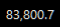

# btc-taskbar

Binance USDT-M **BTCUSDT Perpetual** 마크 프라이스(mark price)를 Windows 작업표시줄에
실시간으로 띄워주는 경량 유틸리티입니다. TrafficMonitor처럼 배경 없이 텍스트만
작업표시줄 위에 표시하고, 시스템 트레이 아이콘으로 제어합니다.

Shows the live **BTCUSDT perpetual mark price** (Binance USDT-M futures) directly
on the Windows taskbar — transparent, click-through, background-only.



## Features

- 작업표시줄 오버레이: `BTC 81,338.1 +0.42%` — 투명 배경, 클릭-통과, 포커스 없음
- Alt+Tab / Win+Tab / 작업표시줄 버튼 어디에도 나타나지 않음 (완전 백그라운드)
- 트레이 아이콘: 등락률 색상 배경 + 툴팁에 전체 가격
- 트레이 메뉴:
  - **표시 옵션** — 심볼(BTC) / 가격 / 등락률 개별 on/off
  - **배경색** — 없음(투명) 또는 팔레트 색상
  - **위치 조정** — 좌/우/상/하 미세 이동 또는 드래그로 직접 배치
  - **시작 프로그램으로 자동 실행** — 레지스트리 Run 등록/해제
- 설정은 `settings.json`에 저장되어 재시작 후 유지
- 자동 복구: Win+D/바탕화면 보기로 최소화돼도 자동 복귀, 창 소멸 시 워치독 재기동
- 작업표시줄 밝기를 샘플링해서 라이트 테마면 자동으로 어두운 텍스트
- 단일 인스턴스 보장 (named mutex)

## Data source

| 값 | 엔드포인트 |
|---|---|
| 가격 | `GET https://fapi.binance.com/fapi/v1/premiumIndex?symbol=BTCUSDT` → `markPrice` |
| 등락률 | `GET https://fapi.binance.com/fapi/v1/ticker/24hr?symbol=BTCUSDT` → `priceChangePercent` |

~1.2초 폴링. 오프라인이면 마지막 가격이 회색으로 표시됩니다.

## Install & run

### 방법 A: Python 스크립트

```sh
pip install -r requirements.txt
python btc_taskbar.py          # 테스트 실행
start_hidden.vbs               # 콘솔 없이 백그라운드 실행
```

### 방법 B: exe (Python 불필요)

`BtcTaskbar.exe`를 실행하면 끝. 직접 빌드하려면:

```sh
pip install pyinstaller
pyinstaller --noconsole --onefile --name BtcTaskbar btc_taskbar.py
# -> dist/BtcTaskbar.exe
```

### 자동 실행

트레이 아이콘 우클릭 → **"시작 프로그램으로 자동 실행"** 체크.
(수동으로는 `start_hidden.vbs` 또는 exe의 바로가기를 `Win+R` → `shell:startup`에 복사)

## Options (파일 상단 상수)

- `MARK_URL` / `PCT_URL` — 다른 심볼로 변경 가능 (`ETHUSDT` 등)
- `POLL_SEC` — 폴링 주기 (기본 1.2s)
- `EDGE_GAP` — 트레이 영역과의 간격
- `FONT` — 표시 폰트

## Notes

- Windows 전용 (Win32 API 사용)
- 작업표시줄의 다른 오버레이(TrafficMonitor 등)와 위치를 자동으로 피해 배치합니다
- 두 엔드포인트를 순차 조회하므로 가격과 등락률이 같은 시각이 아닐 수 있습니다 (~수십 ms 차이)
